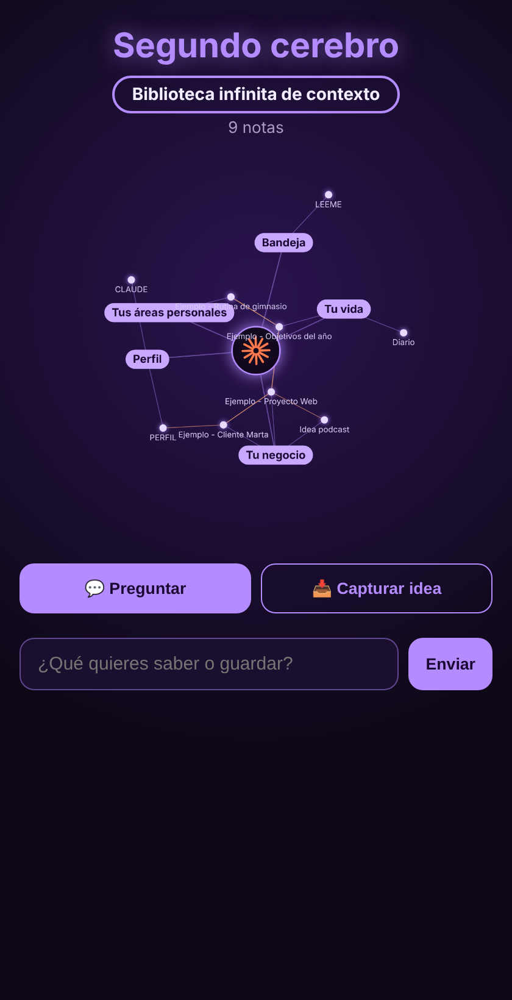

# 🧠 Proyecto 2/5 — Segundo cerebro

Una **biblioteca infinita de contexto** sobre **tu vida**, **tu negocio** y **tus áreas personales**,
guardada como notas Markdown (compatible con **Obsidian**). Claude la lee, la ordena y la amplía,
así que **cuanto más la usas, mejor te conoce**.

- **Pregúntale**: «¿Qué le prometí a Marta?», «¿Cómo voy con mis objetivos del año?». Busca en tus notas y cita las que usa.
- **Cuéntale cosas**: lo que sea duradero lo guarda solo en la nota correcta, con enlaces `[[...]]`.
- **Captura rápida**: suelta ideas, apuntes o transcripciones de notas de voz y las archiva por temas.
- **Bandeja**: echa archivos en `vault/00-Bandeja/` y los procesa todos de golpe.
- **PERFIL.md**: un resumen de quién eres que Claude lee en cada conversación (y actualiza él mismo).
- **Grafo visual** de tus notas, como el del vídeo, con chat integrado.



## Instalación

```bash
cd 02-segundo-cerebro
python -m venv .venv && source .venv/bin/activate
pip install -r requirements.txt
cp .env.example .env   # opcional si ya tienes la clave en proyectos-claude/.env;
```

¿Ya usas Obsidian? Pon `VAULT_PATH=/ruta/a/tu/vault` en `.env`. Si no, usa la carpeta `vault/` incluida
(puedes abrirla como vault en Obsidian para verla con su grafo).

## Uso

```bash
python -m cerebro.cli conoceme                 # 1ª vez: te entrevista y crea tu perfil
python -m cerebro.cli                          # chat: pregunta o cuéntale cosas
python -m cerebro.cli capturar "idea: hacer un podcast con clientes"
python -m cerebro.cli importar apuntes.md reunion.txt
python -m cerebro.cli bandeja                  # procesa vault/00-Bandeja

uvicorn cerebro.server:app --port 8001         # web con grafo + chat → http://localhost:8001
```

### Con Claude Code o Claude Desktop (sin programar)

El vault trae un `CLAUDE.md` con las instrucciones. Abre Claude Code dentro de la carpeta `vault/`
(o conéctala a Claude Desktop con el conector de sistema de archivos) y trabajará igual: lee tu perfil,
busca en tus notas y archiva lo nuevo.

## Estructura del vault

```
vault/
  PERFIL.md        quién eres (Claude lo lee siempre)
  CLAUDE.md        instrucciones para Claude Code
  00-Bandeja/      material sin procesar
  10-Vida/         personas, familia, objetivos, diario
  20-Negocio/      clientes, productos, ideas, procesos
  30-Areas/        Salud, Finanzas, Relaciones, Aprendizaje
  90-Plantillas/   plantillas (Claude no las toca)
```

Las notas que empiezan por «Ejemplo -» son de muestra: bórralas cuando tengas las tuyas.

## Seguridad y privacidad

- Tus notas viven en tu disco. Solo se envía a Claude lo que hace falta para cada pregunta.
- Claude no puede escribir fuera del vault, y nunca borra notas (solo crea, amplía o reescribe).
- Si tu vault es privado, **no lo subas a un repositorio público**.
