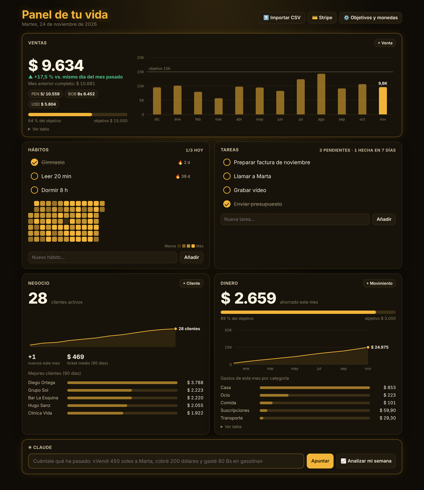

# 📊 Proyecto 3/5 — Panel de tu vida

**Todo en un solo sitio**: ventas, hábitos, tareas, negocio y dinero, con gráficos, y Claude para
apuntar cosas hablando normal y para analizar tu semana.



| Tarjeta | Qué muestra |
|---|---|
| **Ventas** | total del mes, % frente al mismo día del mes pasado, barra de progreso al objetivo y gráfico de 12 meses |
| **Hábitos** | checklist diario con rachas 🔥 y mapa de calor de las últimas 12 semanas |
| **Tareas** | pendientes y hechas hoy (tachadas) |
| **Negocio** | clientes activos, evolución, nuevos del mes, ticket medio y mejores clientes |
| **Dinero** | ahorrado este mes frente a tu objetivo, ahorro acumulado y gastos por categoría |
| **✳ Claude** | escribe «vendí 450 soles a Marta, cobré 200 dólares y gasté 80 Bs en gasolina» y lo apunta todo; «Analizar mi semana» te da 3 acciones concretas |

Todos los gráficos tienen tooltip al pasar el ratón y una vista de tabla («Ver tabla»). Modo claro y oscuro automáticos.

## Instalación

```bash
cd 03-panel-de-tu-vida
python -m venv .venv && source .venv/bin/activate
pip install -r requirements.txt
cp .env.example .env               # pon tu ANTHROPIC_API_KEY
python -m panel.seed               # (opcional) datos de ejemplo para verlo lleno
uvicorn panel.server:app --port 8002
```

Abre **http://localhost:8002**. Cuando quieras empezar con tus datos reales, borra `panel.db` y empieza a apuntar.

## De dónde salen los datos

- **A mano** desde el panel (botones «+ Venta», «+ Movimiento», «+ Cliente») o hablando con Claude.
- **CSV** («Importar CSV»): exporta de tu banco, Shopify, Excel o tu programa de facturas. Detecta solo las
  columnas de fecha, importe, cliente, concepto y categoría (formatos `1.200,50` y `1,200.50`, separador `,` o `;`).
  Del banco: importes negativos = gastos, positivos = ingresos.
- **Stripe** (botón «Stripe»): pon `STRIPE_API_KEY` en `.env` (clave restringida de solo lectura) e importa
  los cobros del último año sin duplicar.
- **Objetivos y monedas** (⚙️): objetivo de ventas y de ahorro mensual, moneda principal y tipos de cambio.

## Varias monedas (dólares, soles, bolivianos, euros)

Cada venta o movimiento se guarda en **su moneda** (USD `$`, PEN `S/`, BOB `Bs`, EUR `€`) y el panel lo
**convierte todo a tu moneda principal** para los totales y gráficos. Debajo de las ventas del mes ves el
desglose por moneda, y en las listas cada importe aparece en su moneda original.

- Elige la moneda principal en ⚙️ (al cambiarla, los objetivos se convierten solos).
- Los tipos de cambio (unidades por 1 dólar) se editan a mano o con **🌐 Actualizar de internet**
  (open.er-api.com, gratis y sin clave). Por defecto: 1 $ = 3,75 S/ = 6,96 Bs = 0,92 €.
- A Claude puedes hablarle en cualquier moneda: «soles», «S/», «bolivianos», «Bs», «dólares», «$».
- En los CSV, si hay una columna `moneda` la usa; si no, eliges la moneda del archivo al importar.
- Stripe trae la moneda de cada cobro.

## Estructura

```
panel/
  db.py         SQLite + cálculo de métricas
  agent.py      Claude: apuntar en lenguaje natural + análisis semanal
  importers.py  CSV y Stripe
  server.py     API web
  seed.py       datos de ejemplo
  web/index.html  el panel (gráficos SVG sin librerías)
```
