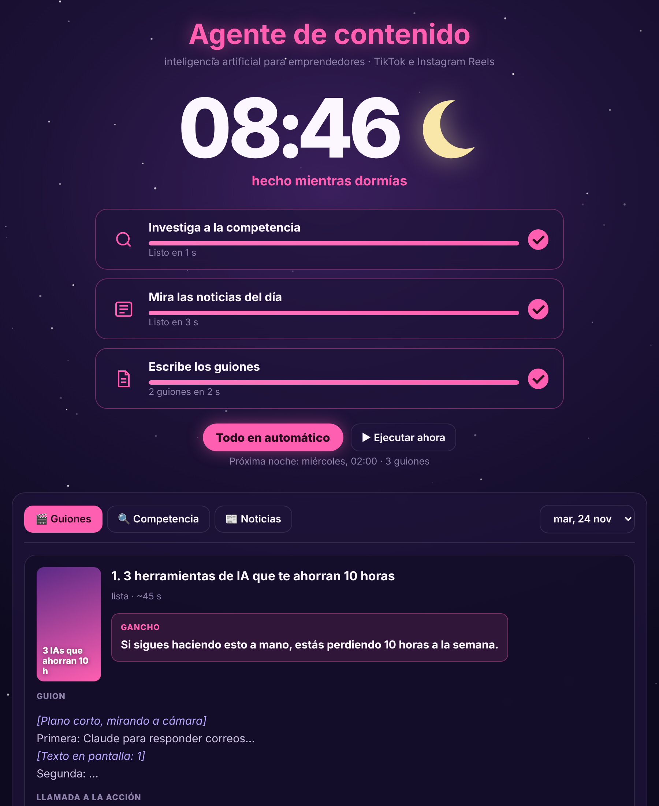

# 🌙 Proyecto 4/5 — Agente de contenido

Mientras duermes, Claude hace el trabajo que te come las mañanas:

1. **Investiga a la competencia** — busca en internet qué están publicando, qué les funciona y qué huecos dejan.
2. **Mira las noticias del día** — las 5-8 noticias de tu nicho de las últimas 24-48 h, con ángulo para vídeo y fuente.
3. **Escribe los guiones** — N guiones listos para grabar: gancho, guion con indicaciones visuales, CTA,
   texto de portada, descripción con hashtags y por qué funcionará. Con tu tono (`marca.md`).

Los pasos 1 y 2 van en paralelo. Todo se guarda en `salidas/AAAA-MM-DD/` (Markdown + JSON) y lo ves en una web
con el reloj, la luna y el progreso en directo de cada tarea. **Todo en automático.**



## Instalación

```bash
cd 04-agente-de-contenido
python -m venv .venv && source .venv/bin/activate
pip install -r requirements.txt
cp .env.example .env      # tu ANTHROPIC_API_KEY, nicho, competidores, hora…
```

Edita **`marca.md`** con tu tono, audiencia y reglas: es lo que hace que los guiones suenen a ti.

## Uso

```bash
uvicorn contenido.server:app --port 8003   # web + trabaja solo cada noche a la HORA de .env
python -m contenido.run                    # o ejecútalo ahora mismo desde la terminal
```

Abre **http://localhost:8003** y pulsa «▶ Ejecutar ahora» para probarlo (tarda unos minutos).

> Para que trabaje de noche, el ordenador o servidor tiene que estar encendido. Alternativa sin servidor web:
> añade a cron `0 3 * * * cd /ruta/04-agente-de-contenido && .venv/bin/python -m contenido.run`.

## Coste

Usa la búsqueda web de Claude (unas 20 búsquedas por noche) y Claude Opus 5.5 con razonamiento alto. Mira el
consumo en console.anthropic.com los primeros días y ajusta `NUM_GUIONES` o la frecuencia.
