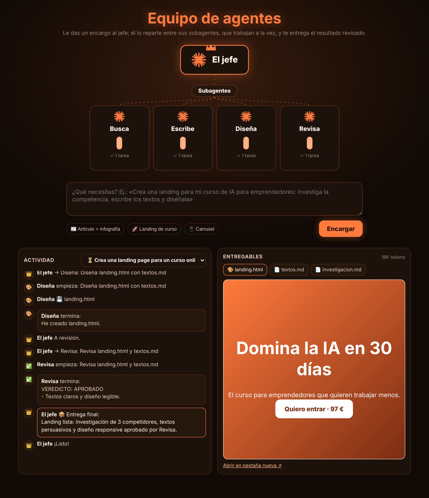

# 👑 Proyecto 5/5 — Equipo de agentes

Un **jefe** y cuatro **subagentes** especialistas. Tú le das un encargo al jefe; él lo divide, lo reparte
(los subagentes trabajan **a la vez**), lo manda a revisión y te entrega el resultado. Es como tener empleados.

| Agente | Qué hace | Herramientas |
|---|---|---|
| 👑 **El jefe** | planifica, delega, decide y entrega | delegar (en paralelo), leer archivos, entregar |
| 🔎 **Busca** | investiga en internet con fuentes | búsqueda web, leer webs, guardar archivos |
| ✍️ **Escribe** | redacta textos (copys, artículos, guiones, emails) | leer/guardar archivos |
| 🎨 **Diseña** | crea piezas visuales en HTML/SVG (landing, carrusel, infografía) | leer/guardar archivos |
| ✅ **Revisa** | control de calidad: «APROBADO» o lista de cambios | leer archivos |

El jefe siempre pasa el trabajo por **Revisa** y, si pide cambios, lo corrige (máx. 2 rondas).



## Instalación y uso

```bash
cd 05-equipo-de-agentes
python -m venv .venv && source .venv/bin/activate
pip install -r requirements.txt
cp .env.example .env   # opcional si ya tienes la clave en proyectos-claude/.env

uvicorn equipo.server:app --port 8004     # web → http://localhost:8004
python -m equipo "Crea una landing para mi curso de IA"   # o desde la terminal
```

En la web ves el organigrama en directo (qué agente trabaja y en qué), el registro de actividad y los
entregables con vista previa. Cada trabajo se guarda en `trabajos/<id>/archivos/`.

Ideas de encargos:
- «Investiga las 5 tendencias de IA de este mes, escribe un artículo de 800 palabras y diseña una infografía.»
- «Landing para mi curso de 97 €: investiga la competencia, escribe los textos y diséñala.»
- «Carrusel de Instagram de 6 diapositivas con consejos para usar Claude en el trabajo.»

## Seguridad

- Los agentes solo pueden leer y escribir dentro de la carpeta de su trabajo, y solo texto (.md, .html, .svg…).
- Las piezas HTML que crean se muestran aisladas (sin JavaScript ni acceso a la aplicación).
- Un trabajo completo usa bastantes tokens (varios agentes con Claude Opus 5.5): mira el contador de la web.
  Para abaratar, pon `EQUIPO_MODELO_SUBAGENTES=claude-sonnet-5-5`.

## ¿Y sin servidor propio?

Esta versión corre en tu ordenador con la API de mensajes de Claude. Anthropic también ofrece **Managed Agents**
(beta), que aloja el bucle de los agentes y sus herramientas en la nube con equipos multiagente nativos; es una
alternativa si prefieres no mantener el servidor.
