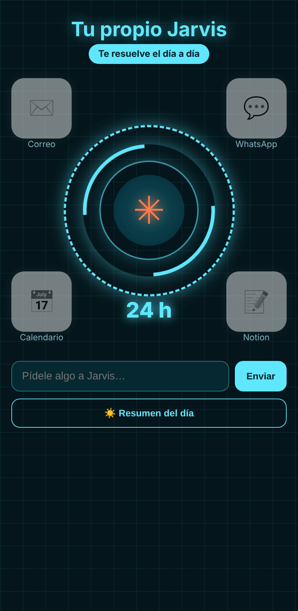
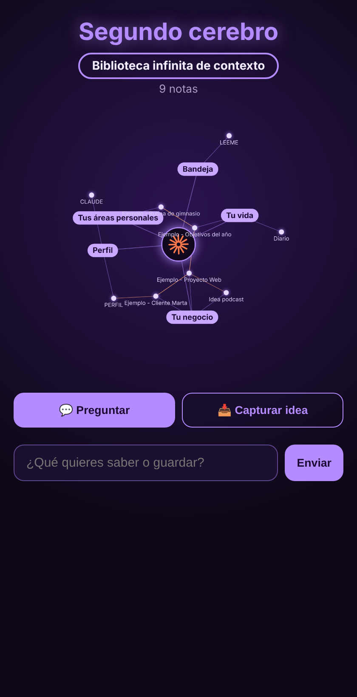
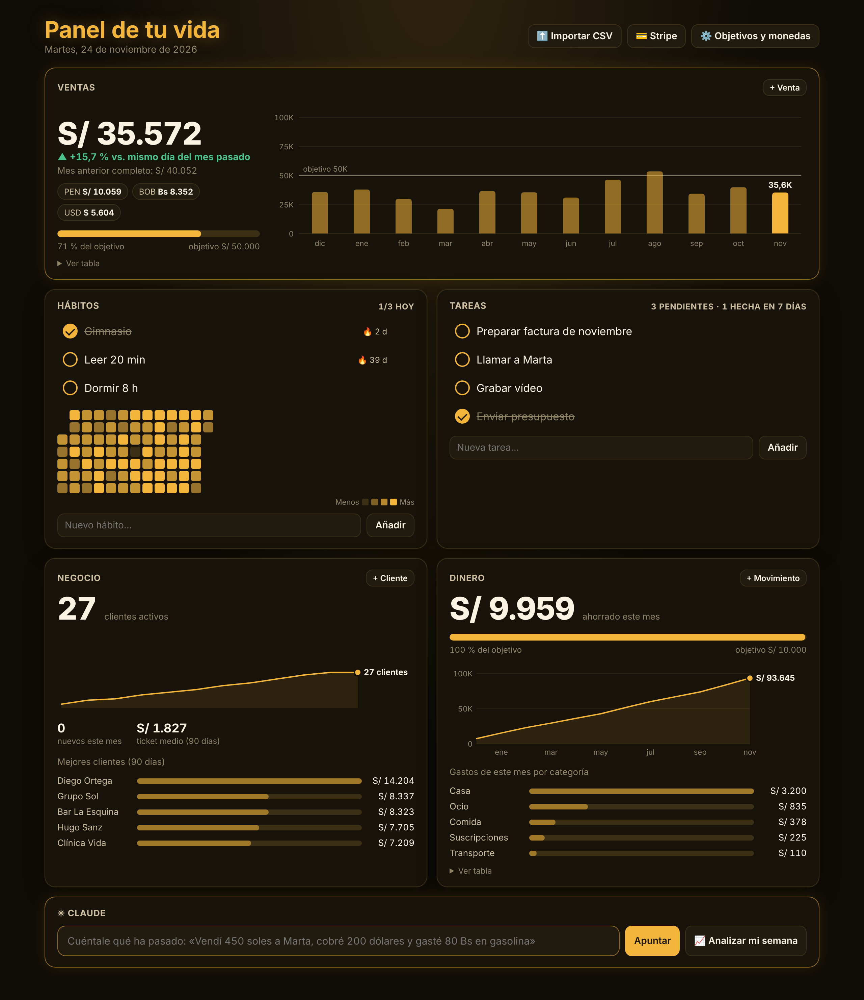
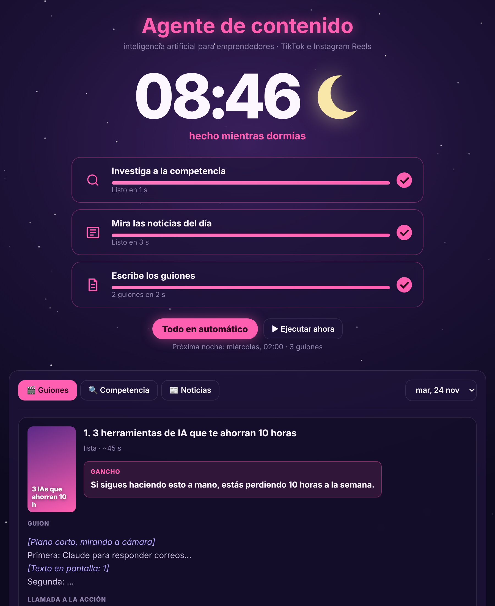
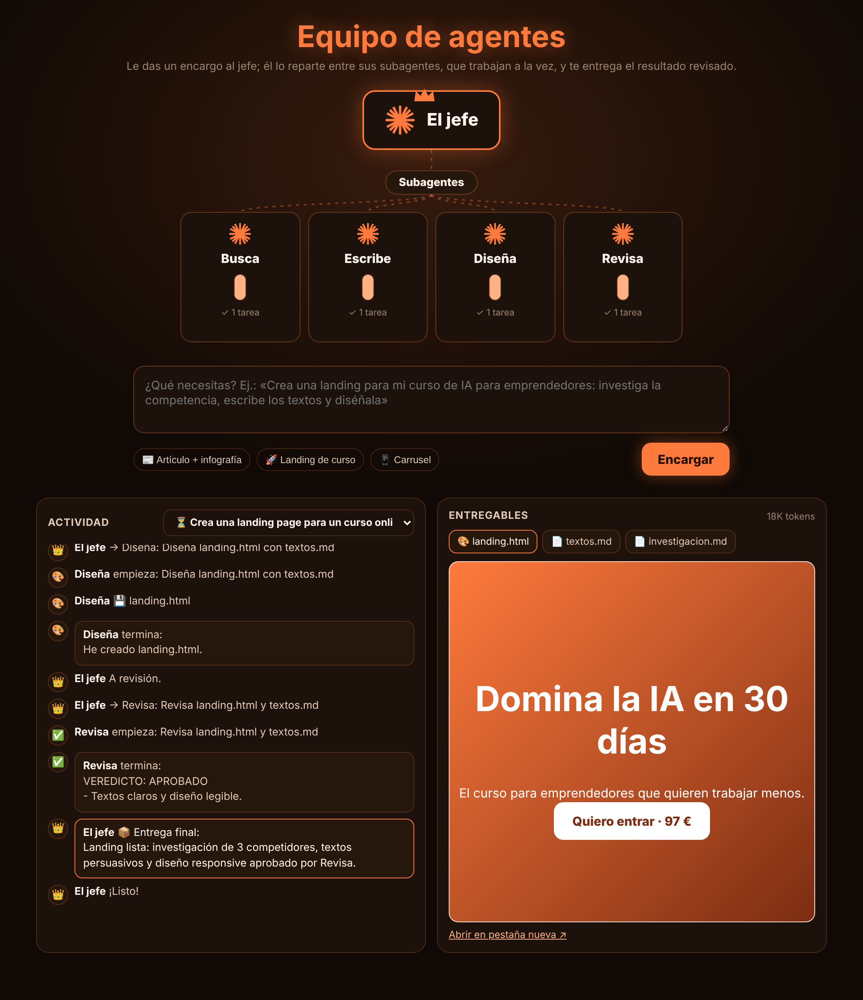

# 5 proyectos con Claude

Cinco aplicaciones listas para usar, hechas con la API de Claude (Claude Opus 5.5). Cada una tiene su web
con interfaz propia, funciona en modo demostración sin configurar nada extra y se activa al poner tus claves.

| # | Proyecto | Qué hace | Puerto |
|---|---|---|---|
| 1 | [🤖 Tu propio Jarvis](01-jarvis/) | Asistente 24 h conectado a Gmail, Calendar, Notion y WhatsApp. Te resuelve el día a día | 8000 |
| 2 | [🧠 Segundo cerebro](02-segundo-cerebro/) | Biblioteca infinita de contexto sobre tu vida, tu negocio y tus áreas (Obsidian + Claude) | 8001 |
| 3 | [📊 Panel de tu vida](03-panel-de-tu-vida/) | Ventas, hábitos, tareas, negocio y dinero con gráficos, todo en un solo sitio | 8002 |
| 4 | [🌙 Agente de contenido](04-agente-de-contenido/) | Cada noche investiga a la competencia, mira las noticias y escribe tus guiones | 8003 |
| 5 | [👑 Equipo de agentes](05-equipo-de-agentes/) | Un jefe que reparte el trabajo entre Busca, Escribe, Diseña y Revisa | 8004 |

<p>
 
 

</p>

## Arrancar los cinco a la vez

```bash
cd proyectos-claude
python -m venv .venv && source .venv/bin/activate     # Windows: .venv\Scripts\activate
pip install -r requirements.txt
echo "ANTHROPIC_API_KEY=sk-ant-..." > .env
(cd 03-panel-de-tu-vida && python -m panel.seed)      # opcional: datos de ejemplo para el panel
python iniciar.py
```

O entra en la carpeta de cada proyecto y sigue su README para arrancarlo por separado y configurar sus
integraciones (Gmail, Notion, WhatsApp, Stripe…).

## Qué necesitas

| | Para qué | Obligatorio |
|---|---|---|
| `ANTHROPIC_API_KEY` | todos | ✅ |
| Google Cloud `credentials.json` | Jarvis: Gmail + Calendar | opcional |
| Token de Notion | Jarvis: tareas | opcional |
| Twilio (WhatsApp) + URL pública | Jarvis: hablarle por WhatsApp | opcional |
| `STRIPE_API_KEY` (solo lectura) | Panel: importar ventas | opcional |
| Webhook de Slack/Discord | Agente de contenido: aviso al terminar | opcional |

## Privacidad

Las claves van en archivos `.env`, que nunca se suben al repositorio. Tus datos (notas, panel, trabajos)
se guardan en tu disco. Si el repositorio es público, no subas tu vault personal ni tus bases de datos.
